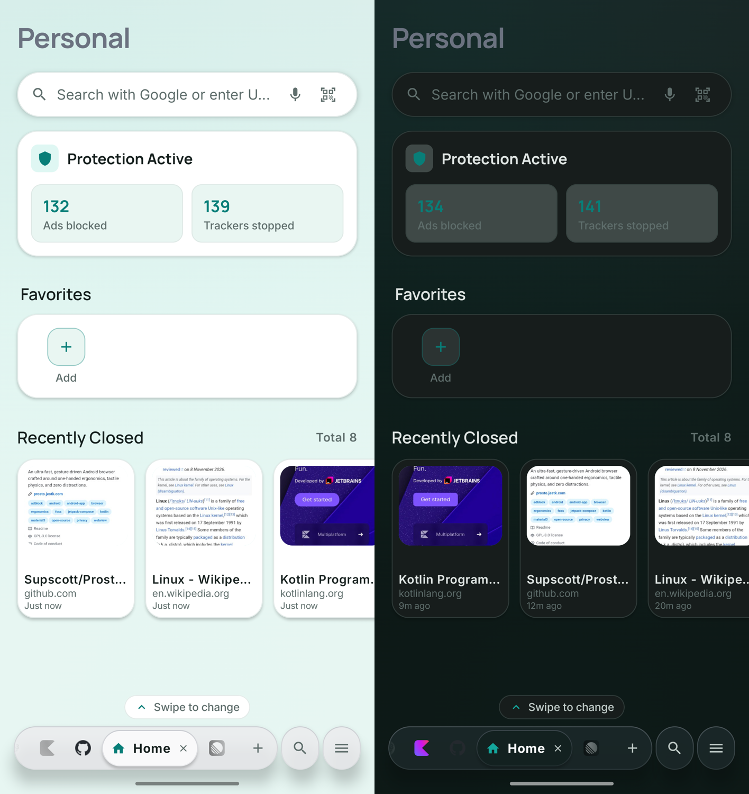
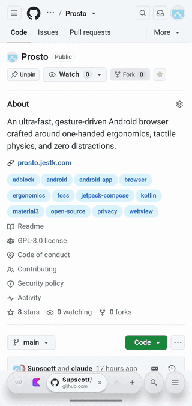
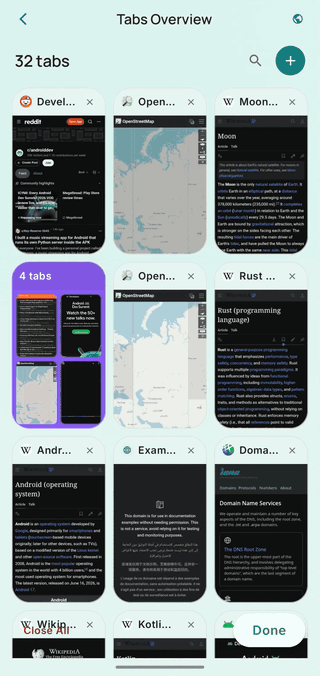
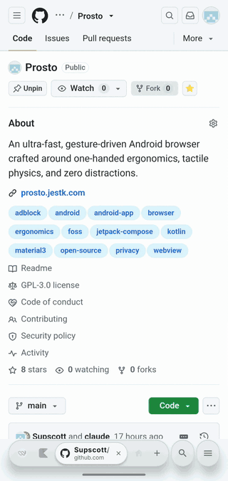

<div align="center">

  

  # Prosto Browser

  **A new way to interact with the internet.**

  An ultra-fast, gesture-driven Android browser crafted around one-handed ergonomics, tactile physics, and zero distractions.

  [](https://github.com/Supscott/Prosto/releases/latest/download/prosto.apk)

  <sub>Android 8.0+ · free · GPL-3.0 · no telemetry</sub>

  [](https://github.com/Supscott/Prosto/releases)
  [](https://www.gnu.org/licenses/gpl-3.0)
  [-34D399.svg?style=flat-square)](https://developer.android.com/about/versions/oreo)
  [](https://kotlinlang.org)
  [](https://developer.android.com/jetpack/compose)
  [](CONTRIBUTING.md)

</div>

<p align="center">
  
</p>

---

## 💡 Why Prosto?

Most mobile browsers hide your tabs behind a button and keep their controls at the top of a screen that is too tall to reach. Prosto is built around one idea: **make working with the browser more convenient**.

- **Tabs always in sight:** the dock at the bottom of the screen shows your open tabs, so you switch between them with one tap or swipe.
- **Everything within thumb reach:** tabs, search and navigation live in the bottom third of the display.
- **Instant feel:** a warm engine, preconnect and a last-frame hold make new tabs open and tab switches happen without a blank flash.
- **Privacy by default:** built-in ad and tracker blocking, zero telemetry, no analytics.
- **Solid, tactile UI:** precision micro-borders and elevation shadows, strictly **no blur** shaders wasting battery or GPU cycles.

---

## ✨ Key Features

### 🗂️ Tabs & Folders
- **Dock-first tabs:** open tabs stay on the dock; drag to reorder with spring physics.
- **Folders in the dock and the tab grid:** group tabs into folders. In the tab grid a folder opens in place, not in a modal dialog.
- **Gesture dock:** the dock hides while you scroll down and returns on a slight upward flick.

### 🎨 Workspaces
- **Independent spaces:** each workspace has its own tabs, favorites, history and recently closed tabs, with isolated cookies and logins.
- **Your color:** pick a color per workspace and the whole interface is tinted to match.
- **Swipe-up switcher:** swipe up on the dock to pick a workspace from a carousel, just like choosing an app in Android Recents.

### ⚡ Instant Loading
- **Warm engine and preconnect** so pages start loading right away.
- **Tab history restored** and a **back/forward cache** for instant Back.
- **No flashing:** the previous frame stays on screen until the new page paints.

### 🔍 Search
- **Engine carousel:** fling across search engines right in the omnibox.
- **Power prefixes:** switch engines as you type (e.g. `g <query>`, `d <query>`, `k <query>`).
- **Custom providers** with your own URL templates.

### 🛡️ Ad & Tracker Blocker
- **Fast request filtering** with a compact domain index, built from open filter lists.
- **Cosmetic filtering** hides empty ad containers without layout shifts.
- **Live statistics** of blocked ads and trackers on the Home screen.

### 📥 Downloads
- Pause, resume and cancel; interrupted transfers resume via HTTP `Range`.

### 🎬 In Action

<table>
  <tr>
    <td align="center"><br/><sub>Tabs always on the dock</sub></td>
    <td align="center"><br/><sub>Folders open in place</sub></td>
    <td align="center"><br/><sub>Swipe up to pick a workspace</sub></td>
  </tr>
</table>

---

## 📥 Download & Installation

Get the latest release directly from GitHub:

[](https://github.com/Supscott/Prosto/releases/latest/download/prosto.apk)

> Requires **Android 8.0+ (Oreo, API 26+)**. See all versions and checksums on the [Releases page](https://github.com/Supscott/Prosto/releases).

---

## 🛠️ Building from Source

### Prerequisites
- **JDK:** OpenJDK 17 or JDK 23
- **Android SDK:** Compile SDK 35, Build Tools 35.0.0
- **Gradle:** Wrapper included

```bash
# Build debug APK
./gradlew assembleDebug

# Build optimized release APK (with R8 minification)
./gradlew assembleRelease

# Run unit and Robolectric tests
./gradlew :app:testDebugUnitTest

# Check architectural invariants (no blur, domain purity)
python3 tools/check_invariants.py
```

---

## 🏗️ Architecture & Tech Stack

Prosto follows Clean Architecture principles with Jetpack Compose:
- **UI:** Jetpack Compose with Material 3 (BOM `2025.12.00`)
- **Database:** AndroidX Room with SQLite 3.18 support
- **Engine:** Android WebKit with custom pooling and nested scroll integration
- **Networking:** OkHttp 4.12 & Coil Compose
- **Concurrency:** Kotlin Coroutines & `StateFlow`
- **Domain Purity:** The `domain/` layer is pure Kotlin with zero Android framework dependencies.

---

## 🗺️ Planned Features

- [ ] **Smart Tab Auto-Grouping:** Context-aware automatic tab grouping by URL domain and topic.
- [ ] **Cross-Device Sync:** Secure cloud synchronization for open tabs, bookmarks, and settings.
- [ ] **Plugins & Mods:** User-scriptable extensions and community add-ons.

---

## 🤝 Contributing

Contributions are welcome! Whether it's reporting a bug, proposing a new feature, or submitting a pull request:
1. Check existing [Issues](https://github.com/Supscott/Prosto/issues) or create a new one.
2. Read our [Contributing Guidelines](CONTRIBUTING.md).
3. Ensure all tests pass before submitting (`./gradlew :app:testDebugUnitTest`).

---

## 📜 License

Prosto Browser is licensed under the [GNU General Public License v3.0 (GPL-3.0)](LICENSE).
