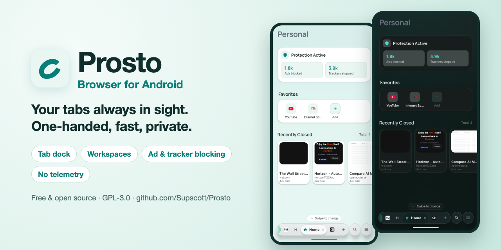
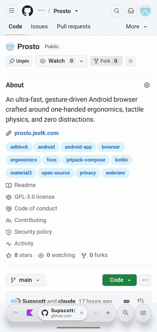

<div align="center">

  [](https://github.com/Supscott/Prosto/releases)
  [](https://www.gnu.org/licenses/gpl-3.0)
  [-34D399.svg?style=flat-square)](https://developer.android.com/about/versions/oreo)
  [](https://kotlinlang.org)
  [](https://developer.android.com/jetpack/compose)
  [](CONTRIBUTING.md)

  

  [](https://github.com/Supscott/Prosto/releases/latest/download/prosto.apk)

  <sub>Android 8.0+ · free · GPL-3.0 · no telemetry</sub>

  <sub>If Prosto is useful to you, a ⭐ helps others find it.</sub>

</div>

<table align="center">
  <tr>
    <td align="center"><br/><sub>Tabs always on the dock</sub></td>
    <td align="center"><br/><sub>Folders open in place</sub></td>
    <td align="center"><br/><sub>Swipe up to pick a workspace</sub></td>
  </tr>
</table>

> **Join the closed test.** Prosto is coming to Google Play, and Google requires 12 testers for 14 days first. If you are on Android 8.0+, [sign up here](https://forms.gle/2txbUY8orJMC7czk6) (one minute). You will get a Play opt-in link by email; staying opted in for 14 days is all it takes.

---

## 💡 Why Prosto?

Most mobile browsers hide your tabs behind a button. Prosto is built around one idea: **make working with the browser more convenient**.

- **Tabs always in sight:** the dock at the bottom of the screen shows your open tabs, so you switch between them with one tap or swipe.
- **Instant feel:** a warm engine, preconnect and a last-frame hold make new tabs open and tab switches happen without a blank flash.
- **Privacy by default:** a real ad-blocking engine with standard filter lists, incognito tabs, zero telemetry, no analytics.

---

## ✨ Key Features

### 🗂️ Tabs & Folders
- **Dock-first tabs:** open tabs stay on the dock; drag to reorder with spring physics, or drag a tab up off the dock to close it.
- **Folders in the dock and the tab grid:** group tabs into folders. In the tab grid a folder opens in place, not in a modal dialog.
- **Folder suggestions:** when three or more tabs are open on the same site, Prosto offers to group them into a folder.
- **Incognito tabs:** long-press "+" and pick an incognito tab. It runs in a separate profile, keeps its cookies and storage apart, saves no history, blocks screenshots and is wiped when you close it. A violet dock and a mask badge show you are in one.
- **Fresh start:** come back after 30 minutes away and a new tab is waiting, with a pill that takes you back to the last one.
- **Gesture dock:** the dock hides while you scroll down and returns on a slight upward flick.

### 🎨 Workspaces
- **Independent spaces:** each workspace has its own tabs, favorites, history and recently closed tabs, with isolated cookies and logins.
- **Your color:** pick a color per workspace and the whole interface is tinted to match.
- **Swipe-up switcher:** swipe up on the dock to pick a workspace from a carousel, just like choosing an app in Android Recents.

### ⚡ Instant Loading
- **Warm engine and preconnect** so pages start loading right away.
- **Tab history restored** and a **back/forward cache** for instant Back.
- **No flashing:** the previous frame stays on screen until the new page paints.

### 🔍 Search
- **Engine carousel:** fling across search engines right in the omnibox.
- **Inline autocomplete** from your history, and a shortcut to switch to a tab that already has the page open.
- **Power prefixes:** switch engines as you type (e.g. `g <query>`, `d <query>`, `k <query>`).
- **Custom providers** with your own URL templates.

### 🛡️ Ad & Tracker Blocking
- **Native engine:** requests are filtered by [adblock-rust](https://github.com/brave/adblock-rust), the engine behind Brave, compiled into the app.
- **Standard filter lists:** EasyList, EasyPrivacy, uBlock Origin filters, AdGuard mobile and tracking lists and RU AdList, updated in the background.
- **Cosmetic filtering and scriptlets:** hides ad containers without layout shifts and runs uBlock Origin scriptlets for sites that need them.
- **Popup and popunder blocking**, with a one-tap "Allow for this site".
- **Cookie banners dismissed for you:** tracking cookies are rejected automatically (can be turned off).
- **Per-site allowlist** in each workspace, and **live statistics** of blocked ads and trackers on the Home screen.
- **Sites still work:** sign-ins and Cloudflare security checks are never touched by blocking or injected scripts.

### 🎧 Video & Apps
- **Clean YouTube Player:** open a YouTube video in a distraction-free, ad-free player.
- **Background playback:** turn it on in Settings and audio and video keep playing with the screen off or the app in the background.
- **Picture-in-picture:** a fullscreen video continues in a floating window when you leave the app.
- **Fullscreen rotation:** fullscreen videos turn to landscape on their own.
- **Open in app:** links that have an app (Telegram, Instagram and others) offer to open it; turn the offer off per site.

### 📥 Downloads
- Pause, resume and cancel; interrupted transfers resume via HTTP `Range`.
- Prosto asks before downloading a file you already have.
- A failed download says so in an in-app pill instead of failing silently.

### ⚙️ Settings & Updates
- **Quick tour:** a short stories-style tour with animated scenes shows the gestures; start it from the Home screen card or from Settings → About.
- **Organised settings:** categories with their own screens, and quick-toggle tiles for the switches you use most.
- **In-app updates:** Prosto checks GitHub Releases for a new version, shows an update card and downloads the APK for you to install.

---

## 📥 Download & Installation

Get the latest release directly from GitHub:

[](https://github.com/Supscott/Prosto/releases/latest/download/prosto.apk)

> Requires **Android 8.0+ (Oreo, API 26+)**. See all versions and checksums on the [Releases page](https://github.com/Supscott/Prosto/releases).

---

## 🛠️ Building from Source

### Prerequisites
- **JDK:** OpenJDK 17 or JDK 23
- **Android SDK:** Compile SDK 35, Build Tools 35.0.0
- **Gradle:** Wrapper included
- **Rust:** not needed. The native blocking library ships prebuilt for `arm64-v8a`, `armeabi-v7a` and `x86_64`; see [`native/adblock-jni/README.md`](native/adblock-jni/README.md) to rebuild it.

```bash
# Build debug APK
./gradlew assembleDebug

# Build optimized release APK (with R8 minification)
./gradlew assembleRelease

# Run unit and Robolectric tests
./gradlew :app:testDebugUnitTest

# Check architectural invariants (domain purity, script stealth, file size)
python3 tools/check_invariants.py
```

---

## 🏗️ Architecture & Tech Stack

Prosto follows Clean Architecture principles with Jetpack Compose:
- **UI:** Jetpack Compose with Material 3 (BOM `2025.12.00`)
- **Engine:** Android WebView (AndroidX WebKit) with a warm WebView pool, separate profiles per workspace and for incognito, and nested scroll integration
- **Content blocking:** [adblock-rust](https://crates.io/crates/adblock) `0.13.5` through a JNI bridge (`native/adblock-jni`)
- **Database:** AndroidX Room 2.6
- **Networking:** OkHttp 4.12 & Coil 2.7
- **Concurrency:** Kotlin Coroutines & `StateFlow`
- **Domain Purity:** The `domain/` layer is pure Kotlin with zero Android framework dependencies.

---

## 🗺️ Planned Features

- [ ] **Smart Tab Auto-Grouping** *(partly done)*: Prosto already suggests a folder for tabs of one site; automatic grouping by topic is next.
- [ ] **Cross-Device Sync:** Secure cloud synchronization for open tabs, bookmarks, and settings.
- [ ] **Plugins & Mods:** User-scriptable extensions and community add-ons.

---

## 🤝 Contributing

Contributions are welcome! Whether it's reporting a bug, proposing a new feature, or submitting a pull request:
1. Check existing [Issues](https://github.com/Supscott/Prosto/issues) or create a new one.
2. Read our [Contributing Guidelines](CONTRIBUTING.md).
3. Ensure all tests pass before submitting (`./gradlew :app:testDebugUnitTest`).

---

## 📜 License

Prosto Browser is licensed under the [GNU General Public License v3.0 (GPL-3.0)](LICENSE).


The native content-blocking library (`native/adblock-jni`) statically links [adblock-rust](https://crates.io/crates/adblock/0.13.5) (Brave Software), licensed under the [Mozilla Public License 2.0](LICENSES/MPL-2.0.txt). Its exact source is the crates.io release `adblock 0.13.5`.
