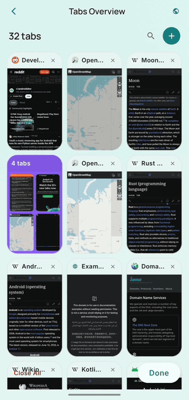
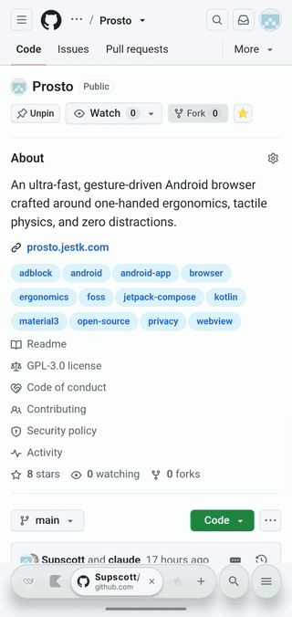

<div align="center">

  

  [](https://github.com/Supscott/Prosto/releases/latest/download/prosto.apk)

  [](https://github.com/Supscott/Prosto/releases)
  [](https://www.gnu.org/licenses/gpl-3.0)
  [-34D399.svg?style=flat-square)](https://developer.android.com/about/versions/oreo)
  [](https://kotlinlang.org)
  [](https://developer.android.com/jetpack/compose)
  [](CONTRIBUTING.md)

  <sub>Android 8.0+ · free · GPL-3.0 · no telemetry</sub>

  <sub>If Prosto is useful to you, a ⭐ helps others find it.</sub>

  [Features](#features) · [Install](#install) · [Privacy](#privacy) · [Known limitations](#known-limitations) · [Build](#build-from-source) · [Contributing](#contributing)

</div>

**Prosto is a free, open-source browser for Android that keeps your tabs in sight.** The dock at the bottom of the screen shows them all, so you switch with one tap or swipe, with one hand.

**It is for people who keep many tabs open.** Ads and trackers are blocked by a real engine with standard filter lists, and the app sends no telemetry.

---

## Features

<table>
  <tr>
    <td valign="top">
      <b>Your tabs are always on the dock.</b><br/>
      Tap a tab to switch. Drag to reorder with spring physics, or drag a tab up off the dock to close it. The dock hides while you scroll down and returns on a slight upward flick.
    </td>
    <td align="center" width="260">
      <a href="assets/switch-tabs.gif"></a><br/><sub>Tabs always on the dock</sub>
    </td>
  </tr>
  <tr>
    <td valign="top">
      <b>Folders open in place.</b><br/>
      Group tabs into folders in the dock and in the tab grid. In the grid a folder opens right there, not in a modal dialog. When three or more tabs are open on the same site, Prosto offers to group them.
    </td>
    <td align="center" width="260">
      <a href="assets/folder.gif"></a><br/><sub>Folders open in place</sub>
    </td>
  </tr>
  <tr>
    <td valign="top">
      <b>Workspaces keep your contexts apart.</b><br/>
      Each workspace has its own tabs, favorites, history and recently closed tabs, with isolated cookies and logins. Pick a color per workspace and the whole interface is tinted to match. Swipe up on the dock to choose one from a carousel, like picking an app in Android Recents.
    </td>
    <td align="center" width="260">
      <a href="assets/workspaces.gif"></a><br/><sub>Swipe up to pick a workspace</sub>
    </td>
  </tr>
</table>

### And also

- **Incognito tabs:** long-press "+" and pick an incognito tab. It runs in a separate profile, keeps its cookies and storage apart, saves no history, blocks screenshots and is wiped when you close it. A violet dock and a mask badge show you are in one.
- **Fresh start:** come back after 30 minutes away and a new tab is waiting, with a pill that takes you back to the last one.
- **Instant loading:** a warm engine and preconnect start pages right away. Tab history is restored, a back/forward cache makes Back instant, and the previous frame stays on screen until the new page paints, so there is no blank flash.
- **Search:** fling across search engines in the omnibox, or switch as you type with a prefix (`g <query>`, `d <query>`, `k <query>`). Autocomplete comes from your history, with a shortcut to a tab that already has the page open. You can add providers with your own URL templates.
- **Ad and tracker blocking:** requests are filtered by [adblock-rust](https://github.com/brave/adblock-rust), the engine behind Brave, compiled into the app. It uses EasyList, EasyPrivacy, uBlock Origin filters, AdGuard mobile and tracking lists and RU AdList, updated in the background.
- **Cosmetic filtering and scriptlets:** ad containers are hidden without layout shifts, and uBlock Origin scriptlets run on the sites that need them.
- **Popups, cookie banners, allowlist:** popups and popunders are blocked, with a one-tap "Allow for this site". Cookie banners are dismissed by rejecting tracking cookies (you can turn this off). Each workspace has a per-site allowlist, and the Home screen shows live statistics of blocked ads and trackers.
- **Sites still work:** sign-ins and Cloudflare security checks are never touched by blocking or injected scripts.
- **Video:** open a YouTube video in the Clean YouTube Player, without distractions or ads. Turn on background playback in Settings and audio and video keep playing with the screen off. Fullscreen video continues in picture-in-picture when you leave the app, and turns to landscape on its own.
- **Open in app:** links that have an app (Telegram, Instagram and others) offer to open it. You can turn the offer off per site.
- **Downloads:** pause, resume and cancel. Interrupted transfers resume via HTTP `Range`. Prosto asks before downloading a file you already have, and a failed download says so in an in-app pill.
- **Settings and tour:** settings are grouped into categories with their own screens, plus quick-toggle tiles for the switches you use most. A short stories-style tour shows the gestures; start it from the Home screen card or from Settings → About.
- **In-app updates:** Prosto checks GitHub Releases for a new version, shows an update card and downloads the APK for you to install.

---

## Install

| Source | Link | Notes |
| --- | --- | --- |
| GitHub release | [prosto.apk](https://github.com/Supscott/Prosto/releases/latest/download/prosto.apk) | Android 8.0+ (API 26+). All versions and checksums are on the [Releases page](https://github.com/Supscott/Prosto/releases). |
| Google Play | Closed test, [sign up below](#join-the-closed-test) | Not public yet. |
| Source | [Build from source](#build-from-source) | No Rust needed. |

### Join the closed test

Prosto is coming to Google Play, and Google requires 12 testers for 14 days first. If you are on Android 8.0+, [sign up here](https://forms.gle/2txbUY8orJMC7czk6) (one minute). You will get a Play opt-in link by email; staying opted in for 14 days is all it takes.

---

## Privacy

Prosto has no analytics and no telemetry. Your tabs, history, favorites and settings stay on your phone. These are the network requests Prosto makes besides loading the pages you open:

| What | Goes to | When |
| --- | --- | --- |
| Update check | `api.github.com` and `github.com` (Prosto releases) | Automatically, while **Check for updates** in Settings is on (it is on by default). You can also check by hand. |
| Filter lists | The list publishers: `easylist.to`, `ublockorigin.github.io`, `filters.adtidy.org` (AdGuard), `secure.fanboy.co.nz`, `easylist-downloads.adblockplus.org` | About once a day on an unmetered connection, or when you tap "Update filter lists now". The lists also ship inside the APK. |
| Site icons | Google's favicon service, `www.google.com/s2/favicons` | When a site gives no icon of its own, and for the icons of the default search engines. The request carries the site's domain. Local addresses (`localhost`, `192.168.x.x` and similar) are skipped. |

Also good to know:

- Prosto asks for the list of installed apps, only to find an app that can open a link ("Open in app").
- Plain HTTP pages are allowed. Prosto warns you when a connection is not encrypted.
- Incognito tabs save no history and are wiped when you close them. The sites you visit still see your connection, as in any browser.

---

## Known limitations

- **The engine is Android WebView, not our own Chromium.** Page compatibility and speed follow the WebView version on your phone. Keep Android System WebView updated.
- **No extensions.** Ad blocking is built in, with the standard lists. User scripts and add-ons are [planned](#planned).
- **No sync.** Tabs, favorites and settings live on one phone. Cross-device sync is [planned](#planned).
- **Android 8.0 (API 26) and newer only.** There is no iOS or desktop version.
- **Not on Google Play yet.** Install the APK from GitHub or join the [closed test](#join-the-closed-test). Updates come from GitHub Releases.
- **The blocking library is prebuilt for three ABIs:** `arm64-v8a`, `armeabi-v7a` and `x86_64`.
- **Blocking is not perfect.** A filter can break a site or miss an ad. Use "Allow for this site" when a page does not work.
- **Prosto is at version 0.x.** Things still change between releases.

---

## Build from source

You need:

- **JDK:** OpenJDK 17 or JDK 23
- **Android SDK:** Compile SDK 35, Build Tools 35.0.0
- **Gradle:** the wrapper is included
- **Rust:** not needed. The native blocking library ships prebuilt for `arm64-v8a`, `armeabi-v7a` and `x86_64`; see [`native/adblock-jni/README.md`](native/adblock-jni/README.md) to rebuild it.

```bash
# Build debug APK
./gradlew assembleDebug

# Build optimized release APK (with R8 minification)
./gradlew assembleRelease

# Run unit and Robolectric tests
./gradlew :app:testDebugUnitTest

# Check architectural invariants (domain purity, script stealth, file size)
python3 tools/check_invariants.py
```

### Tech stack

Prosto follows Clean Architecture principles with Jetpack Compose.

| Layer | Choice |
| --- | --- |
| UI | Jetpack Compose with Material 3 (BOM `2025.12.00`) |
| Engine | Android WebView (AndroidX WebKit) with a warm WebView pool, separate profiles per workspace and for incognito, and nested scroll integration |
| Content blocking | [adblock-rust](https://crates.io/crates/adblock) `0.13.5` through a JNI bridge (`native/adblock-jni`) |
| Database | AndroidX Room 2.6 |
| Networking | OkHttp 4.12 and Coil 2.7 |
| Concurrency | Kotlin Coroutines and `StateFlow` |
| Domain | The `domain/` layer is pure Kotlin with zero Android framework dependencies |

---

## Planned

- [ ] **Smart tab auto-grouping** *(partly done)*: Prosto already suggests a folder for tabs of one site; automatic grouping by topic is next.
- [ ] **Cross-device sync:** secure cloud synchronization for open tabs, favorites and settings.
- [ ] **Plugins and mods:** user-scriptable extensions and community add-ons.

---

## Contributing

Bug reports, ideas and pull requests are welcome. Check the existing [issues](https://github.com/Supscott/Prosto/issues) or open a new one. [CONTRIBUTING.md](CONTRIBUTING.md) covers the dev setup, tests, commit style and how to report a bug. To report a security problem, follow [SECURITY.md](SECURITY.md) instead of opening a public issue.

---

## License

Prosto Browser is licensed under the [GNU General Public License v3.0 (GPL-3.0)](LICENSE).

The native content-blocking library (`native/adblock-jni`) statically links [adblock-rust](https://crates.io/crates/adblock/0.13.5) (Brave Software), licensed under the [Mozilla Public License 2.0](LICENSES/MPL-2.0.txt). Its exact source is the crates.io release `adblock 0.13.5`. The bundled filter lists and their licences are listed in [`LICENSES/filter-lists.md`](LICENSES/filter-lists.md).
