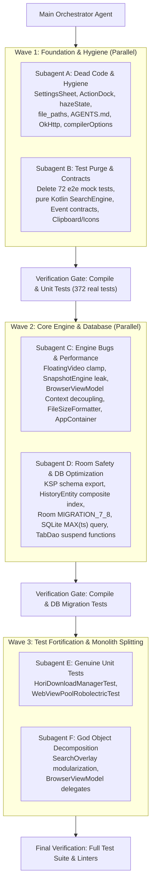

# Implementation Plan: Technical Debt Resolution via Subagents with Latest-Stable (AGP 9.4+ / Kotlin 2.4+ / Room 3.0+) Migration Readiness

## Goal Description

Resolve critical technical debt, security/data-loss vulnerabilities, fake test coverage, and architectural decay across Hori Android Browser as identified in [`tech-debt.md`](file:///Users/ilya/CODING/browser/.worktrees/fix/tech-debt/tech-debt.md) and approved by the Senior Architecture Reviewer.

The execution is orchestrated through specialized subagents executing decoupled tracks, with strict forward-compatibility for the target 2026 latest stable ecosystem:
- **Android Gradle Plugin (AGP):** `9.4+` (Gradle `9.6+` or AGP `9.0+` on Gradle `9.1+`, Java 21/23 toolchain)
- **Kotlin Language & Toolchain:** `2.4.10` (KSP 2.x, native Compose compiler plugin, `compilerOptions` DSL)
- **Room Database:** `3.0.2` (`withWriteTransaction`, explicit migration scripts, strict schema export validation)
- **Image Loading:** `Coil 3.6.0` (`io.coil-kt.coil3:coil-compose`, `coil-network-okhttp`, package `coil3.*`)
- **Jetpack Compose:** `BOM 2026.x` (`LocalClipboard`, `Icons.AutoMirrored.*`, SDK 36/37 edge-to-edge defaults)

---

## User Review Required

> [!IMPORTANT]
> **1. Test Suite Realignment (TEST-01):**  
> Deleting the 72 synthetic Java mock test files in `app/src/test/java/com/jestk/browser/e2e/` (337 mock tests) will leave **372 genuine unit and Robolectric tests** active and green. This removes fake coverage without degrading real regression safety.
>
> **2. Room Database Migration 7 -> 8 (SEC-01 & Room 3.0 Readiness):**  
> Adding the composite index on `HistoryEntity (url, timestamp)` mutates the schema hash. We bump database `version = 8`, implement explicit `MIGRATION_7_8`, generate the formal schema JSON, and configure `fallbackToDestructiveMigrationOnDowngrade()`.
>
> **3. Pure Kotlin Modernization:**  
> Remove `@JvmField` / `@JvmStatic` shims while retaining a clean Kotlin parser `SearchEngine.valueOf(raw)` for SQL settings mapper compatibility.

---

## Verified Latest-Stable Compatibility Matrix (Context7)

| Component | Current in Repo | Latest Stable (Verified Context7) | Tech Debt Forward-Compatibility Action |
|---|---|---|---|
| **Android Gradle Plugin (AGP)** | `8.13.2` | **`9.4+`** | Prepare build scripts for AGP 9.4 (decouple build features, remove legacy transform properties). |
| **Gradle** | `8.14.5` | **`9.1.x`** / **`9.6.x`** | Ensure no deprecated Gradle 8 APIs in plugins or build scripts. Keep daemon on JDK 23. |
| **Kotlin** | `2.0.21` | **`2.4.10`** | Replace deprecated `kotlinOptions { jvmTarget = "17" }` with `compilerOptions { jvmTarget.set(JvmTarget.JVM_17) }`. Prune `@JvmField` / `@JvmStatic` shims. |
| **Room** | `2.6.1` | **`3.0.2`** | Configure `room.schemaLocation` in KSP; set `exportSchema = true`; make all DAO mutations `suspend` (`TabDao.reorderTabs`); add `MIGRATION_7_8`. |
| **Coil** | `2.7.0` | **`3.6.0`** (`io.coil-kt.coil3`) | Explicitly declare `com.squareup.okhttp3:okhttp:4.12.0` in `build.gradle.kts` (Coil 3 drops transitive OkHttp); structure `FaviconManager.toImageModel()` to return clean models compatible with Coil 3. |
| **Compose / Material 3** | BOM `2025.12.00` | **BOM `2026.x` / API 37** | Replace `LocalClipboardManager` with `LocalClipboard` (coroutine-scoped); migrate icons to `AutoMirrored`; remove deprecated `isStatusBarContrastEnforced`. |
| **Android SQLite** | API 26 (SQLite 3.18) | API 36/37 | Maintain query compatibility down to SQLite 3.18.2 (`minSdk = 26`). Reject `ROW_NUMBER() OVER (...)` window functions which require SQLite 3.25+ (API 30+). |

---

## Subagent Execution Architecture



---

## Proposed Changes

### Track A: Build Hygiene, Dead Code Removal & Config (Subagent A)

#### [MODIFY] `app/build.gradle.kts`
- Declare explicit direct dependency on `com.squareup.okhttp3:okhttp:4.12.0`.
- Migrate deprecated `kotlinOptions` block to modern `compilerOptions` in the `kotlin {}` extension block.
- Configure KSP `room.schemaLocation` for schema export.
- Enable `isMinifyEnabled = true` and `isShrinkResources = true` in `release` build type.

#### [MODIFY] `app/src/main/java/com/jestk/browser/ui/overlays/SettingsSheet.kt`
- Replace 948 lines of duplicate UI with a 20-line deprecated forwarding stub to `SettingsScreen`.

#### [MODIFY] `app/src/main/java/com/jestk/browser/ui/navigation/ActionDock.kt`
- Remove unused 128-line `fun ActionDock` composable (lines 88–216).
- Retain `ActionPopupMenu` and its supporting components.

#### [MODIFY] `BottomBar.kt`, `ActionDock.kt`, and `Theme.kt`
- Remove phantom `hazeState: Any? = null` parameter from:
  - `UnifiedBottomBar`, `ActionPopupMenu`, `ActionDockMenuButton`, and `BottomBar` in [`BottomBar.kt`](file:///Users/ilya/CODING/browser/.worktrees/fix/tech-debt/app/src/main/java/com/jestk/browser/ui/navigation/BottomBar.kt)
  - `ActionPopupMenu` and `ActionDock` in [`ActionDock.kt`](file:///Users/ilya/CODING/browser/.worktrees/fix/tech-debt/app/src/main/java/com/jestk/browser/ui/navigation/ActionDock.kt)
  - `liquidFrostedGlass` overloads in [`Theme.kt`](file:///Users/ilya/CODING/browser/.worktrees/fix/tech-debt/app/src/main/java/com/jestk/browser/ui/theme/Theme.kt)

#### [MODIFY] `app/src/main/java/com/jestk/browser/ui/overlays/SearchOverlay.kt`
- Remove uncalled 5-parameter `searchEngineButtonGestures` overload (lines 2168–2214).
- Update obsolete header docstring referencing "Liquid Pastel Sunset".

#### [MODIFY] `app/src/main/res/xml/file_paths.xml`
- Scope FileProvider paths to prevent exposing root directories.

#### [MODIFY] `AGENTS.md`
- Replace all references to "Liquid Pastel Sunset" and "Haze backdrop blur" with "Serene Canvas (NO BLUR)".
- Update tech stack section removing Haze and referencing modern toolchains.

---

### Track B: Test Suite Purge, Pure Kotlin & Modern Compose Contracts (Subagent B)

#### [DELETE] `app/src/test/java/com/jestk/browser/e2e/tier1/` to `tier4/` (72 files)
- Delete all 72 synthetic Java mock test files (337 mock tests).

#### [MODIFY] `app/src/main/java/com/jestk/browser/domain/model/SearchEngine.kt`
- Remove Java-interop shims (`@JvmField`, `@JvmStatic`, companion `values()`).
- **Retain** Kotlin companion parser `fun valueOf(name: String): SearchEngine` needed by `Mappers.kt:88` and `SettingsRepositoryImpl.kt:47`.

#### [MODIFY] Compose API Deprecations (`LocalClipboard` & `Icons.AutoMirrored`)
- In `AddEditSearchEngineDialog.kt`, `AddFavoriteDialog.kt`, and `HomeScreen.kt`: replace deprecated `LocalClipboardManager` with `LocalClipboard`, invoking suspend methods inside coroutine scope.
- In `AddEditSearchEngineDialog.kt:274`: replace `Icons.Filled.ShortText` with `Icons.AutoMirrored.Filled.ShortText`.
- In `HomeScreen.kt:146`: remove obsolete `hazeState` parameter.
- In `JestkApp.kt:288`: remove deprecated `isStatusBarContrastEnforced`.

#### [MODIFY] `app/src/main/java/com/jestk/browser/ui/viewmodel/BrowserUiEvent.kt` & `BrowserViewModel.kt`
- Move `DismissDownloadSnackbar` and `DownloadStarted` event definitions from `BrowserViewModel.kt` into `BrowserUiEvent.kt`.
- Clean up imports in `BrowserViewModel.kt`.

#### [MODIFY] `app/src/main/java/com/jestk/browser/ui/viewmodel/BrowserUiState.kt` & `BrowserUiEvent.kt`
- Change `val fullscreenCustomView: Any? = null` to `val fullscreenCustomView: android.view.View? = null`.
- Change `SetFullscreenCustomView(val view: Any?, ...)` to `SetFullscreenCustomView(val view: android.view.View?, ...)`.
- Remove redundant casts `as? android.view.View` in `JestkApp.kt:713`.

#### [MODIFY] Prune Orphaned Setting `isMenuExpandedOnWeb` & Update Dependent Tests
- Remove `isMenuExpandedOnWeb` from `BrowserSettings.kt`, `SettingKeys.kt`, `Mappers.kt`, `SettingsRepositoryImpl.kt`, and `BrowserViewModel.kt`.
- Update assertions in [`BrowserViewModelTest.kt`](file:///Users/ilya/CODING/browser/.worktrees/fix/tech-debt/app/src/test/java/com/jestk/browser/ui/viewmodel/BrowserViewModelTest.kt) (lines 748, 770, 852, 863) and [`SettingsRepositoryTest.kt`](file:///Users/ilya/CODING/browser/.worktrees/fix/tech-debt/app/src/test/java/com/jestk/browser/data/repository/SettingsRepositoryTest.kt) (lines 74, 79, 80).

---

### Track C: Engine Bugs, Resource Hygiene & Dependency Injection (Subagent C)

#### [MODIFY] `app/src/main/java/com/jestk/browser/ui/pip/FloatingVideoMiniPlayer.kt`
- Clamp `offsetX` and `offsetY` inside `detectDragGestures` with density-aware pixel conversion to prevent dragging off-screen.

#### [MODIFY] `app/src/main/java/com/jestk/browser/engine/SnapshotEngine.kt`
- Prevent Activity context leak: replace `context.filesDir` with `context.applicationContext.filesDir`.
- Move synchronous pixel color extraction (`getPixel(centerX, topY)`) to the background coroutine before disk writing.

#### [NEW] `app/src/main/java/com/jestk/browser/util/FileSizeFormatter.kt`
- Extract shared file size and progress formatting logic into a reusable utility.

#### [MODIFY] `HoriDownloadService.kt` & `DownloadsScreen.kt`
- Replace duplicated helper functions with calls to `FileSizeFormatter`.

#### [MODIFY] Decouple `Context` from `BrowserViewModel.kt` & Update `AppContainer.kt`
- Remove `private val context: Context? = null` from `BrowserViewModel` constructor.
- Update [`AppContainer.kt:93`](file:///Users/ilya/CODING/browser/.worktrees/fix/tech-debt/app/src/main/java/com/jestk/browser/di/AppContainer.kt#L93) removing `context` argument.
- Delegate snapshot file deletion and favicon cleanup to `FaviconManager` and `SnapshotEngine`.

---

### Track D: Room 3.0 Readiness, Database Resilience & Performance (Subagent D)

#### [MODIFY] `app/src/main/java/com/jestk/browser/data/local/AppDatabase.kt`
- Bump version to `8`: `@Database(..., version = 8, exportSchema = true)`.
- Implement `MIGRATION_7_8`:
  ```kotlin
  val MIGRATION_7_8 = object : Migration(7, 8) {
      override fun migrate(db: SupportSQLiteDatabase) {
          db.execSQL("CREATE INDEX IF NOT EXISTS `index_history_url_timestamp` ON `history` (`url`, `timestamp`)")
      }
  }
  ```
- Register migration via `.addMigrations(MIGRATION_7_8)`.
- Change `.fallbackToDestructiveMigration()` to `.fallbackToDestructiveMigrationOnDowngrade()`.

#### [MODIFY] `app/src/main/java/com/jestk/browser/data/local/entity/HistoryEntity.kt`
- Add composite index on `(url, timestamp)` to optimize grouping and history search.

#### [MODIFY] `app/src/main/java/com/jestk/browser/data/local/dao/HistoryDao.kt`
- Replace O(N²) correlated subquery with SQLite `MAX(timestamp)` join compatible with SQLite 3.18 / minSdk 26 across `getAllHistoryFlow`, `getRecentHistory`, `getPagedHistory`, and `searchHistory`.

#### [MODIFY] `app/src/main/java/com/jestk/browser/data/local/dao/TabDao.kt`
- Mark blocking functions `reorderTabs`, `reorderTabIds`, and `updatePosition` as `suspend` (mandatory for Room 3.0 coroutine safety).

---

### Track E: Genuine Test Suite Coverage (Subagent E)

#### [NEW] `app/src/test/java/com/jestk/browser/engine/download/HoriDownloadManagerTest.kt`
- Unit tests covering chunked downloading, pause/resume, download cancellation, and speed calculation.

#### [NEW] `app/src/test/java/com/jestk/browser/engine/WebViewPoolRobolectricTest.kt`
- Robolectric tests covering LRU eviction (max 5 WebViews), context detachment via `MutableContextWrapper`, and theme color extraction.

---

### Track F: High-Churn Monolith Modularization (Subagent F)

#### [MODIFY] Decompose `SearchOverlay.kt` (2,525 LOC)
- [NEW] `SearchEngineCarousel.kt`: Engine selector carousel physics, spring snapping, and velocity tracking (keep classes `internal` for `SearchOverlayPreviewTest`).
- [NEW] `SearchEngineReorderList.kt`: Drag-and-drop reorderable search engine management card.
- [NEW] `SearchHistoryCard.kt`: Inset grouped history suggestions card with pagination and upward expansion.
- [NEW] `SearchInputPill.kt`: Capsule search input bar with mic and action chips.
- [MODIFY] `SearchOverlay.kt`: Compact orchestrator (~300 LOC).

#### [MODIFY] Decompose `BrowserViewModel.kt` (1,889 LOC)
- Extract domain delegates for `TabCoordinator`, `SearchCoordinator`, and `DownloadCoordinator` to isolate single-responsibility domains.

---

## Verification Plan

### Automated Tests
1. **Gradle Compilation & Lint Check:**
   ```bash
   rtk ./gradlew :app:compileDebugKotlin :app:compileReleaseKotlin
   ```
2. **JVM & Robolectric Test Suite:**
   ```bash
   rtk ./gradlew :app:testDebugUnitTest
   ```
   *Assert:* All genuine unit tests (372 real tests passing, 0 failures).
3. **Room Schema Export Verification:**
   ```bash
   rtk ls -la app/schemas/com.jestk.browser.data.local.AppDatabase/
   ```
   *Assert:* Version 8 JSON schema file is generated.
4. **Release Minification Build Verification:**
   ```bash
   rtk ./gradlew :app:assembleRelease
   ```
   *Assert:* R8 shrinks and obfuscates release APK without ProGuard errors.

### Manual / Visual Verification
1. **Floating Video Mini-Player:** Open a video in fullscreen, trigger PiP/floating mini-player, and drag it against all four screen edges. Verify it smoothly clamps to screen margins and never slips off-screen.
2. **Settings Screen Navigation:** Open Settings from bottom dock popup menu. Verify screen opens full-screen with back navigation and close buttons.
3. **Search Overlay:** Test swipe gesture between search engines, expanded history pagination, and favorites chips.
4. **Downloads:** Trigger a file download, verify notification and download progress in `DownloadsScreen`.
